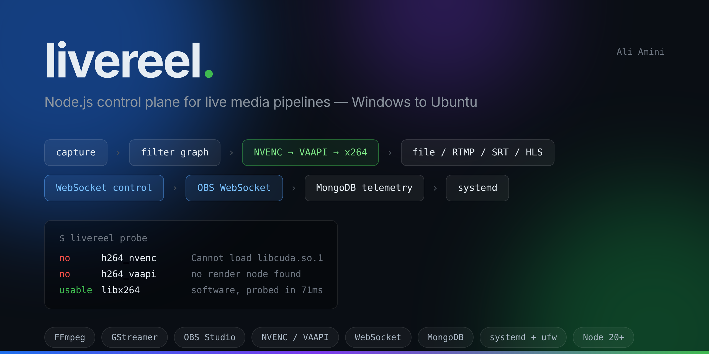

# livereel



A Node.js control plane for live media pipelines. It supervises FFmpeg and GStreamer encodes,
drives OBS Studio over obs-websocket, takes commands on a WebSocket control channel, logs
sessions and telemetry to MongoDB, and runs headless on Linux under systemd.

It was built around one problem in particular: a media service that grew up on a Windows host
and has to run on a hardened Ubuntu box instead. Most of what breaks in that move is not the
media code, and the parts that handle it are called out below.

    

---

## What moving to Linux actually breaks

Each of these is a real failure mode with a specific answer in the code, not a general
portability gesture.

**An encoder that exists but does not work.** `ffmpeg -encoders` lists what the binary was
compiled with. A stock Ubuntu FFmpeg advertises `h264_nvenc` on a machine with no NVIDIA card
at all. Reading that list and believing it is how a pipeline fails at the first frame of a
live session instead of at startup. Every candidate here is proved by encoding three frames
of a synthetic source and checking the exit code, and the result is cached against the host's
FFmpeg build and GPU inventory. On the machine this was developed on:

```
H.264 encoders
  no      h264_nvenc    [h264_nvenc @ 0x…] Cannot load libcuda.so.1
  no      h264_qsv      [h264_qsv @ 0x…] Error creating a MFX session: -9.
  no      h264_vaapi    no render node found
  usable  libx264       software, probed in 71ms
```

The chain falls back `NVENC → QSV → VAAPI → libx264`, and a fallback is written into the
session record with the reason, because "why was this recording software-encoded" is a
question asked after the event. — `src/media/capabilities.js`

**Stopping a process is not killing it.** FFmpeg writing an MP4 holds the index in memory
until it finishes. Kill it with a signal and the file will not play:

```
plain mp4,      SIGKILL mid-encode   17,825,840 bytes  →  "moov atom not found", unplayable
fragmented mp4, SIGKILL mid-encode   18,087,964 bytes  →  75.0 s, reads fine
```

So shutdown is a ladder — ask properly, then escalate — and recordings default to fragmented
MP4 so an unclean exit still leaves something playable. — `src/platform/process.js`

**The polite stop is a different mechanism on each platform.** FFmpeg finishes cleanly on
either SIGINT or `q` on stdin. On Linux the signal works and FFmpeg can be started with
`-nostdin`. On Windows, Node cannot deliver a real SIGINT to a child, so `q` is the only
route — which means `-nostdin` must *not* be set there. Carry the Windows pair over to Linux
unchanged and the stop request goes nowhere, the ladder escalates to SIGKILL, and the
recording is truncated. The supervisor resolves the pair per platform.
— `src/platform/process.js`, `src/media/ffmpeg.js`

**Killing a tree.** Linux spawns into its own process group and signals the negative pid, so
helpers die with the parent. Windows has no equivalent, so it shells out to `taskkill /T`.

**Capture is named differently.** The same webcam is `-f dshow -i video="Integrated Camera"`
on Windows and `-f v4l2 -i /dev/video0` on Linux; the same screen is `gdigrab` or `x11grab`.
Sources are declared by intent and each platform builds its own arguments — including failing
loudly when screen capture is asked for on a headless host with no `DISPLAY`.
— `src/media/sources.js`

**Paths.** Drive letters, backslashes, and the assumption that `Recordings` and `recordings`
are the same directory. Config declares logical roots with a per-platform value; a backslash
is only rewritten when the string really looks like a Windows path, because a backslash is a
legal character in a POSIX filename. Client-supplied paths are contained to their root rather
than resolved outside it. The service also reports at startup when the recordings filesystem
is case-sensitive. — `src/platform/paths.js`

**Filter-graph escaping.** `C:\media\overlay.txt` inside a filter argument needs the drive
colon escaped or FFmpeg reads it as an option separator — the most common filter-graph error
when a config crosses platforms. — `src/media/overlay.js`

**Nothing listens for SIGTERM.** A Windows service never needed to, so the port often does not
either, and `systemctl stop` becomes "the service was killed" rather than "the service
finished its recordings and exited". — `src/cli.js`

---

## What it does

**Dynamic metadata compositing.** Overlay text changes while a session runs, without
restarting FFmpeg: `drawtext` with `textfile` and `reload=1`, and the text file is replaced by
an atomic rename so a frame can never composite a half-written line.

**Machine-readable progress.** Telemetry comes from `-progress pipe:1` as `key=value` lines,
not from scraping the stderr banner. `speed` below 1.0 on a live source is the number worth
alerting on: the encoder is not keeping up.

**GStreamer where it earns its place.** A `tee` with a queue per branch, so one capture feeds
a recording and a preview at once. Without a queue per branch every branch runs on the source
thread, and the recording stutters whenever a preview client connects.

**A control channel that separates two kinds of traffic.** Commands are rare and must not be
lost; telemetry is frequent and worthless once stale. Telemetry is dropped under backpressure,
commands never are. Heartbeats detect the half-open connections that a closed laptop leaves
behind. The port is loopback-only unless a token is set — the server refuses to bind
elsewhere without one.

**Persistence that degrades instead of failing.** Sessions, discrete events and buffered
telemetry go to MongoDB with a TTL index for retention. When MongoDB is unreachable the
service writes newline-delimited JSON instead and reports itself degraded. Losing the database
should cost queryability, not the recording.

**A service, not a script.** systemd unit with `ProtectSystem=strict`, a syscall filter,
`KillMode=mixed` so the service can finish its own children, restart rate limiting, and
journald-native structured logs.

---

## Quick start

```bash
git clone https://github.com/charlie-hk/livereel-media-pipeline
cd livereel-media-pipeline
npm install

# What can this host actually encode?
node src/cli.js probe

# Prove it: a real 5-second pipeline, reporting what it demonstrated.
node src/cli.js selftest --seconds 5

# Run the service.
cp config/livereel.example.json config/livereel.json
node src/cli.js serve
```

Requires Node 20+, FFmpeg, and optionally GStreamer 1.20+, OBS Studio with obs-websocket 5,
and MongoDB.

### Driving it

```js
import { WebSocket } from 'ws';
const ws = new WebSocket('ws://127.0.0.1:8787');

ws.send(JSON.stringify({
  id: '1',
  type: 'session.start',
  source:  { type: 'camera', device: '/dev/video0' },
  outputs: [
    { type: 'file', path: 'show/take1.mp4' },
    { type: 'rtmp', url: 'rtmp://ingest.example/live/key' },
  ],
}));

// Change the burned-in overlay without interrupting the encode.
ws.send(JSON.stringify({ id: '2', type: 'overlay.set', sessionId: 's-1cb089e6', text: 'LIVE' }));
```

`session.start` answers with what it actually did, including any substitution:

```json
{
  "sessionId": "s-1cb089e6",
  "encoder": "libx264",
  "hardware": false,
  "fellBack": true,
  "fallbackReason": "[h264_nvenc @ 0x…] Cannot load libcuda.so.1",
  "outputs": [{ "type": "file", "path": "/var/lib/livereel/recordings/show/take1.mp4" }]
}
```

Commands: `status.get`, `capabilities.get`, `session.start|stop|list`, `overlay.set`,
`pipeline.start|stop`, `obs.scenes|setScene|startRecord|stopRecord|status|setText`,
`ping`, `subscribe`.

Events: `session.started|progress|restart|exit|giveup|stopped`, `pipeline.exit`,
`obs.connected|disconnected|sceneChanged|recordStateChanged`.

### Deploying

```bash
sudo ./deploy/install.sh
sudo -u livereel node /opt/livereel/src/cli.js probe
sudo systemctl enable --now livereel
journalctl -u livereel -f -o cat | jq -c '{ts, level, scope, msg}'
```

`deploy/hardening.md` covers the ufw rules, which systemd restrictions had to be relaxed for a
media workload and why, and the permission failures that disguise themselves as missing
hardware.

---

## Layout

```
src/platform/   paths and process supervision — where the platform differences live
src/media/      capability probe, FFmpeg pipelines, GStreamer pipelines, overlay compositing
src/control/    WebSocket server, wire protocol, OBS client
src/store/      MongoDB store, file fallback
src/service.js  lifecycle: probe, sessions, control, persistence
deploy/         systemd unit, installer, hardening notes
```

About 3,400 lines of source and 900 of tests.

---

## What was verified, and where

Written out plainly, because "supports NVENC" and "ran NVENC" are not the same claim. The
development host was Ubuntu with no NVIDIA GPU, no OBS, and no MongoDB reachable.

| Area | Status | How |
|---|---|---|
| FFmpeg pipeline, overlay, progress parsing | **verified** | Real encodes on Ubuntu 22.04 and 24.04, FFmpeg 4.4 and 6.1, libx264. Valid 1280×720 output, overlay updated 12 times mid-encode. |
| Capability probe and fallback chain | **verified** | NVENC, QSV and VAAPI each correctly rejected on a GPU-less host with the real reason; libx264 accepted; fallback recorded in the session. |
| NVENC encode path | **implemented, not run on hardware** | No NVIDIA GPU on the test host. The probe's *rejection* of NVENC is verified; a successful NVENC encode is not. Run `node src/cli.js probe` on a GPU host to confirm. |
| Graceful stop ladder | **verified** | SIGINT path confirmed; a process trapping both signals is escalated to SIGKILL, under test. |
| Fragmented vs plain MP4 after a hard kill | **verified** | Measured, both files; figures above are from that run. |
| GStreamer tee pipeline | **verified** | GStreamer 1.24, `x264enc`, two branches, clean EOS, valid output file. |
| WebSocket control channel | **verified** | 12 automated tests plus a manual session: auth, backpressure, subscriptions, error codes, path containment. |
| OBS integration | **implemented, not run against OBS** | No OBS on the test host. Written against obs-websocket v5 RPC 1. |
| MongoDB store | **unit-verified only** | Batching, TTL and index specs tested with a stubbed driver. `scripts/verify-mongo.js` checks a live server — not run here, no reachable mongod. |
| systemd unit | **verified syntactically** | `systemd-analyze verify` passes clean. Not run under a live systemd: no PID-1 systemd in the build environment. |
| Windows paths and process handling | **unit-verified only** | Logic is covered by tests; not executed on a Windows host. |

To close the three gaps yourself:

```bash
node src/cli.js probe                                  # NVENC, on a machine with the GPU
docker run -d --rm -p 27017:27017 mongo:8 && \
  node scripts/verify-mongo.js                         # MongoDB, against a real server
sudo ./deploy/install.sh && \
  sudo systemctl start livereel                        # systemd, on a real Ubuntu host
```

---

## License

MIT. See [LICENSE](LICENSE).
